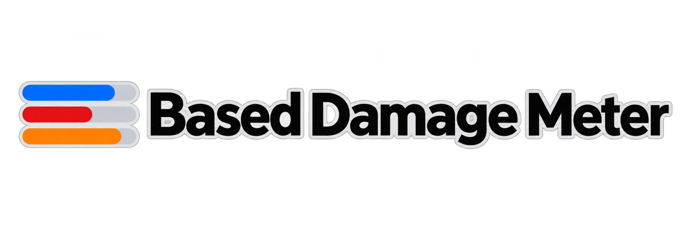

# Based Damage Meter

[](assets/logo.png)

An unofficial damage-meter mod for **Slay the Spire 2**, with solo and multiplayer
views, source breakdowns and credit for the players who provide damage bonuses.
Collection is local; teammates do not need this mod installed.

**Status:** experimental preview, currently `0.3.0-preview.36`, targeting game
`v0.107.1`. Automated checks pass, but native startup, persistence, UI and
host/guest verification remain incomplete. Windows is the current development
and deployment target; Linux/macOS are not verified.

**Known incident:** preview.17 caused save-loading failures and reported progress
loss. It is withdrawn and blocked from packaging/deployment. Preview.18 removed
the offending generic loader patch. The recovery attempt was unsuccessful and
its script is retired. This project does not promise recovery of lost progress.
Read the [incident record](validation/storage-incident-2026-11-03.md) before using
preview builds with valued progress.

[Changelog](CHANGELOG.md) | [Design document](DESIGN.md) | [Third-party notices](THIRD_PARTY_NOTICES.md)

## What it tracks

| View | Meaning |
| --- | --- |
| Effective Damage | HP damage plus block damage from shields later breached by a block-respecting HP hit. Pending block is excluded. |
| Damage (HP + Block) | All observed HP and block damage, with effective bonuses credited to their providers. |
| HP Only / Block Only | Separate destination totals. |
| Poison HP / Doom HP | Actual poison HP loss or confirmed Doom execution damage. Applying Doom earns no HP credit. |
| Amplification | Effective bonuses provided to yourself and teammates; already included in Damage. |
| Support Damage | Bonuses provided to teammates only; already included in Damage. |
| Actual Damage | Observed ownership before bonuses are reassigned to providers. |

For example, a 6-damage hit increased to 9 by another player's Vulnerable credits
6 to the attacker and 3 to the provider. Shared active stacks divide provider
credit proportionally. Caps and remaining HP limit actual bonus credit.

Effective Damage keeps block contributions pending across turns when a shield
persists. Teammates share the breakthrough, retaining their original ownership.
Natural expiration, a new shield after zero, death or combat end discards
unqualified block credit. Poison and Doom HP count but do not unlock block credit.

Unknown ownership stays **Unattributed** and is hidden by default; the header `?`
toggle shows it. Unsupported observations and missing history produce coverage
notices rather than invented credit.

## Using the meter

| Control | Action |
| --- | --- |
| Dropdown | Choose a metric. New installations default to Effective Damage. |
| Scope icon | Toggle Current Fight / This Run; hover to see the active scope. Run history may be partial. |
| ? | Show or hide Unattributed damage. |
| Minus / plus | Collapse to one button / expand to the previous width. |
| Resize arrow | Left-drag to change width; hover for version, help and diagnostics. |
| Grab handle | Left-drag to move. |
| Player bar | Hover for a structured damage breakdown and source table. |
| F8 | Show or hide the panel. |

Multiplayer rows show character icons and player names inside class-coloured bars.
HP and shield damage share the lighter shade; amplification uses the darker shade.
Rows sort by total HP damage regardless of the selected metric. Damage labels are
rounded to whole numbers, with precise values available on hover.

Tooltips retain HP/block/bonus colours and separate **Already included** and
excluded pending amounts. Their content scrolls within bounds relative to the
meter and viewport. Solo play hides player identity and party share. Multiplayer
percentages use the currently visible rows, so toggling Unattributed can change
those percentages. Bar lengths scale against the largest displayed player total.

## Deploy from a checkout (Windows)

Requirements: an installed copy of Slay the Spire 2, the **.NET 9 SDK**, and access
to NuGet for dependency restoration. The project uses Godot.NET.Sdk 4.5.1 and
references runtime assemblies from your game installation.

Close the game completely. From the repository root, run:

```powershell
powershell -NoProfile -ExecutionPolicy Bypass -File scripts/deploy.ps1
```

The script builds Release, runs automated and installed-assembly checks, packages
the mod, checks manifest/DLL versions, copies it into the game, verifies installed
DLL/manifest hashes and requests a Steam launch. It refuses to deploy while the
game is running and blocks preview.17. These checks do not establish native
save/reload or multiplayer correctness.

The default game directory is:

```text
C:\Program Files (x86)\Steam\steamapps\common\Slay the Spire 2
```

For another location:

```powershell
powershell -NoProfile -ExecutionPolicy Bypass -File scripts/deploy.ps1 -GameDir "D:\SteamLibrary\steamapps\common\Slay the Spire 2"
```

After launch, enable **Based Damage Meter (Diagnostic)** in the game's mod menu
and follow any restart prompt. Hover the resize arrow to check the loaded version.

## Build a ZIP or install manually

To build, check and package without installing or launching:

```powershell
powershell -NoProfile -ExecutionPolicy Bypass -File scripts/package.ps1
```

For a non-default installation, pass `-Sts2DataDir` pointing to its
`data_sts2_windows_x86_64` folder. The output is
`artifacts/Based.Spires2DamageMeter-<version>.zip`.

For manual installation, close the game and extract the ZIP's `mods` folder into
the game directory. Keep the host/contract DLLs, manifest and `runtime` directory
together inside:

```text
<game directory>\mods\Based.Spires2DamageMeter
```

Start the game through Steam and enable the mod. To uninstall, close the game and
remove only that mod folder. Leave game-save and user-data folders untouched.

## Development and diagnostics

Development builds support runtime hot reload. **Close the game once** and run:

```powershell
powershell -NoProfile -ExecutionPolicy Bypass -File scripts/deploy.ps1 -Development
```

After installing and enabling that host, repeat the command while the game is
running to build, check and reload UI and runtime logic. To pull GitHub changes
first, run `update.bat -Development` on a branch with a configured upstream.
Compatible meter state is preserved. Host/contract changes require a restart;
failed reloads retain the previous runtime. Hover the resize arrow for status.
See [the hot-reload guide](docs/hot-reload.md) for architecture, options and checks.

Development packaging uses `scripts/package.ps1 -Development` and produces
`artifacts/Based.Spires2DamageMeter-<version>-development.zip`. Keep every packaged
DLL and the `runtime` directory together. Normal deployment still requires a
closed game. Native gameplay and save-safety acceptance remain pending.

[DESIGN.md](DESIGN.md) records accounting decisions and implementation checkpoints;
[CHANGELOG.md](CHANGELOG.md) contains historical preview notes. Mod logs and
statistics live under the game's user-data `Based.Spires2DamageMeter` directory
(on Windows, normally `%APPDATA%\SlayTheSpire2\Based.Spires2DamageMeter`).

For a bug report, include game/mod versions, solo or host/guest role, selected
metric/scope, expected versus observed values and the relevant JSONL event IDs.
Review logs for personal information before sharing. Do not run retired recovery
scripts or assume an automated pass count proves native gameplay safety.

## Credits

**Concept and design - [Kaztelle](https://github.com/KastelleA).**

Observation patterns and overlay lifecycle were adapted from
[BAIGUANGMEI's STS2-DamageTracker](https://github.com/BAIGUANGMEI/STS2-DamageTracker)
under its MIT licence. See [third-party notices](THIRD_PARTY_NOTICES.md) and the
[upstream licence](licenses/DamageTracker-MIT.txt) for attribution and pinned source.
